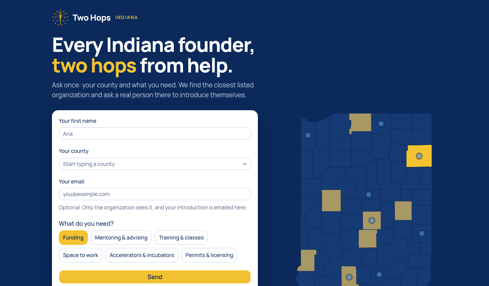
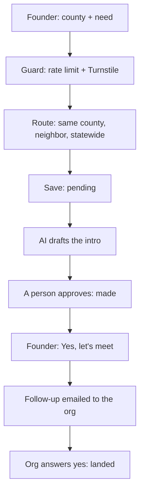

# Two Hops

**211 for Indiana founders, except it counts the handshakes.**



A founder anywhere in Indiana asks once: their county and the kind of help they need. Two Hops routes them to the nearest listed support organization. AI drafts a warm introduction, a person at that organization edits and approves it, and the handshake is recorded. A 92-county map shows where introductions have happened, and how far every county is from one.

Built from an empty repo at the Indy Init AI Hackathon (Launch Fishers, November 7, 2026) by **Chris Lacey** (builds with Claude Code) and **Ryan Allison** (product owner, working through his own agent). Table 25.

- **Live app:** https://twohops.app (backup: https://two-hops.chrislacey89.workers.dev)
- **How we built it:** https://twohops.app/how
- **Decision log:** [DECISIONS.md](DECISIONS.md) · **Plan and ladder:** [PLAN.md](PLAN.md) · **Agent thread:** [docs/alignment-log.md](docs/alignment-log.md)

## Try it in one minute

1. Open https://twohops.app on your phone.
2. Pick **Marion** County and **Accelerators & incubators**, then Send. Two Hops routes you to Elevate Ventures.
3. A person at the organization approves the AI-drafted intro on `/approve` (passcode-protected; we demo this step at the table).
4. Your conversation shows the introduction, and Marion turns gold on the map.

Gold counties have a made introduction (deeper gold means more). A blue dot means a request is waiting on a person. The map's other counties are seeded demo data; Marion is left empty so it turns gold live.

## How it works



| Step          | What happens                                                                                                                                     | Code                                                                                                                                     |
| ------------- | ------------------------------------------------------------------------------------------------------------------------------------------------ | ---------------------------------------------------------------------------------------------------------------------------------------- |
| Guard         | 20 requests a minute per IP, then Cloudflare Turnstile verified on the server                                                                    | [`src/server/frontDoorGuard.ts:16`](src/server/frontDoorGuard.ts#L16)                                                                    |
| Route         | Plain code, no AI: same county, then a neighboring county, then statewide. Orgs tagged with the requested help rank first, then claimed listings | [`src/domain/routing.ts:33`](src/domain/routing.ts#L33)                                                                                  |
| Save          | The request is saved as a pending introduction                                                                                                   | [`src/domain/frontDoor.ts:16`](src/domain/frontDoor.ts#L16)                                                                              |
| Draft         | The only AI call: `gpt-4.1-mini` through Effect, with a 20-second timeout, one retry and typed errors; traced in Langfuse                        | [`src/server/aiDraft.ts:32`](src/server/aiDraft.ts#L32)                                                                                  |
| Approve       | One database batch marks the draft approved and the intro made together; the edit is stored beside the AI's original                             | [`src/domain/introductions.ts:161`](src/domain/introductions.ts#L161), [`src/db/introductionRepo.ts:66`](src/db/introductionRepo.ts#L66) |
| Agree to meet | Schedules exactly one follow-up, only for an approved intro                                                                                      | [`src/domain/followUp.ts:84`](src/domain/followUp.ts#L84)                                                                                |
| Follow up     | A cron job (every minute, plus a page-load backup) emails the org; only a recorded yes marks the intro landed, and a second answer is refused    | [`src/server/followUpCron.ts:16`](src/server/followUpCron.ts#L16), [`src/domain/followUp.ts:111`](src/domain/followUp.ts#L111)           |

The AI drafts. It never sends, routes or changes a record. Every draft stores the AI's text, the person's edit, the model and the prompt version, and each approval or edit is written back to the Langfuse trace as a score.

## Stack

TanStack Start and React on **Cloudflare Workers**, with **D1** (SQLite) through Drizzle. Effect v4 and `@effect/ai-openai` for the AI path, with traces exported to Langfuse over OpenTelemetry. Cloudflare Email Sending, Turnstile, rate limiting and Cron Triggers. shadcn/ui components. Vitest, Biome and Lefthook. GitHub Actions for CI.

**Code layout:** `src/domain/` holds the rules as pure functions with no database or network, each next to its tests. Storage sits behind a small repository interface: D1 in production, in memory in tests. `src/server/` holds the server functions (guard, accounts, AI, email, cron). `src/routes/` holds the pages.

**Data:** 768 organizations from Indiana's public ConnectIND directory (`data/organizations.csv`). We excluded 57 listings with dead websites and 21 whose sites no longer match the organization. Five counties have no organization, and requests there route next door.

## The factory

- **Tests:** 49 Vitest tests, including an end-to-end test of the whole path ([`src/e2e/peakPath.test.ts`](src/e2e/peakPath.test.ts)) that fails if any step breaks.
- **CI on every push:** lint, typecheck, tests and a gitleaks secret scan ([`.github/workflows/ci.yml`](.github/workflows/ci.yml)).
- **Commit gates:** Biome, typecheck, tests and a secret scan on every commit, and a dependency audit on every push ([`lefthook.yml`](lefthook.yml)).
- **Decisions before code:** every call is logged in [DECISIONS.md](DECISIONS.md), tagged Product (needed a yes from Ryan or Chris) or Technical, with what we rejected and why.
- **Two humans, two agents, one thread:** Chris's build agent and Ryan's product agent coordinated through a shared Kody Exchange thread ([live view](https://kody.exchange/t/kx_view_deea2e70b8574bdf5e4475bf5b4453c56fd5ac44640e5396), [export](docs/alignment-log.md)). A feature counted as done only when Ryan accepted it on the live site.
- **Planned by measured pace:** the day ran as a ladder of rungs, re-planned at each checkpoint from actual minutes per accepted rung ([PLAN.md](PLAN.md)).

## Known limits

- When several organizations tie on the routing score, the first one alphabetically wins. Logged in DECISIONS.md; the fix is to spread requests across tied orgs.
- Demo accounts stand in for real organization logins. Ryan approves on behalf of Elevate Ventures, and the approve screen says so.
- The map's other gold counties are seeded demo data, marked in the database and in DECISIONS.md.

## Run it locally

```bash
pnpm install
npx wrangler d1 migrations apply two-hops --local
pnpm dev        # http://localhost:3000
pnpm test       # 49 tests
```

Local secrets go in `.dev.vars` (not committed): `OPENAI_API_KEY`, `APPROVE_PASSCODE`, `RYAN_PASSCODE`, `TURNSTILE_SECRET`, `LANGFUSE_PUBLIC_KEY`, `LANGFUSE_SECRET_KEY`, and `TURNSTILE_OFF=1` for local work.

## License

All rights reserved, Chris Lacey and Ryan Allison. See [LICENSE](LICENSE). The ConnectIND-derived data in `data/` remains under that directory's own terms.
